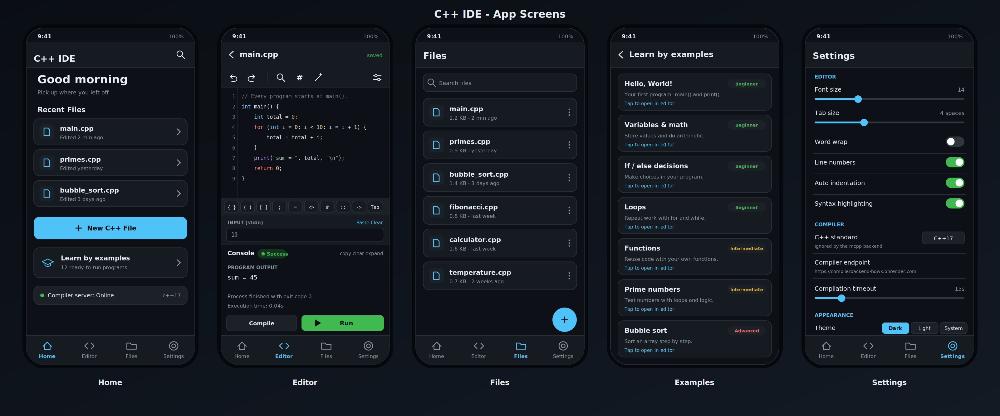
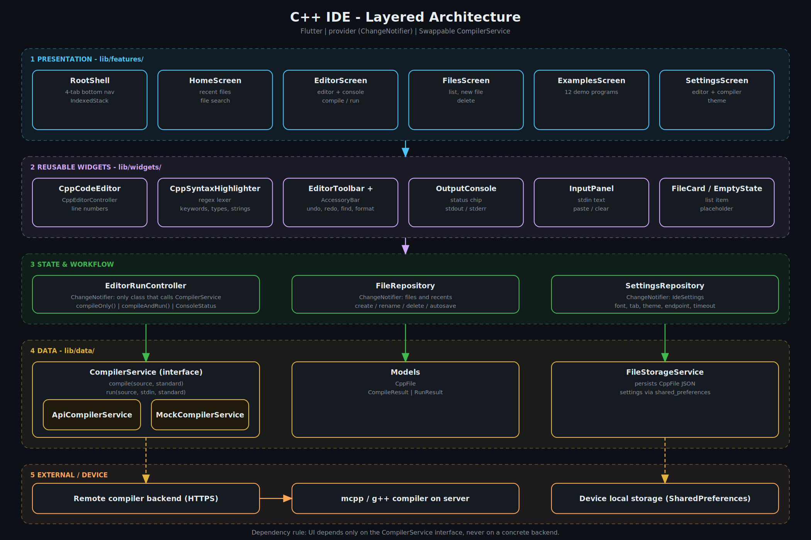
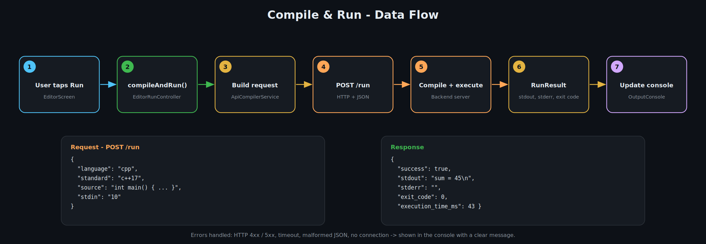

# C++ IDE — Mobile Code Editor & Compiler

A lightweight, professional C++ coding environment for your phone, built with **Flutter**. Write code with syntax highlighting, compile and run it on a remote compiler backend, feed it input, and learn from built-in examples — all from a clean, mobile-first interface.


---

## Preview



---


## Features

**Editor**
- Custom C++ code editor with regex-based **syntax highlighting** (keywords, types, strings, numbers, comments, preprocessor directives, operators)
- **Line numbers**, **word wrap**, and **auto-indentation**
- **Accessory key bar** above the keyboard for fast entry of `{ }`, `( )`, `[ ]`, `;`, `<>`, `::`, `->`, and Tab
- Distraction-free **fullscreen editor** mode
- **Autosave** with a 500 ms debounce, so work is never lost

**Compile & Run**
- **Compile only** or **compile and run** with a single tap
- Multiline **stdin input panel** (with paste, clear, and run-with-input actions)
- Output console showing stdout, stderr, exit code, and execution time, with clear states for idle, compiling, running, success, failure, and network error
- Configurable C++ standard (`c++17`, `c++20`, `c++23`) and request timeout

**Learning**
- **Learn by Examples** library of 12 ready-to-run programs: Hello World, variables & math, if/else, loops, functions, arrays, switch & calculator, tables & patterns, prime numbers, Fibonacci/GCD/digits, bubble sort, and a temperature table
- Starter **templates** when creating a file: Blank, Hello World, Competitive Programming

**File Management**
- Create, open, search, and manage multiple `.cpp` files
- Recent files on the home screen
- All data stored **locally** on the device

**Customization**
- Dark, light, or system theme
- Adjustable font size (10–24), tab size (2–8), and editor toggles
- Editable compiler endpoint, so you can point the app at your own server

---

## Screens

| Tab | Purpose |
|-----|---------|
| **Home** | Greeting, recent files, new-file button, file search, and entry to the examples library |
| **Editor** | Code editor, toolbar, input panel, and output console |
| **Files** | Browse and manage all saved C++ files |
| **Settings** | Editor preferences, compiler options, and theme |

---

## Architecture

The project follows a layered structure that keeps UI free of compiler and storage logic.



The text version of the same structure:

```
┌────────────────────────────────────────────┐
│  features/  +  widgets/        (UI layer)  │
├────────────────────────────────────────────┤
│  EditorRunController           (workflow)  │
├────────────────────────────────────────────┤
│  CompilerService  (interface)              │
│    ├── ApiCompilerService   → HTTP backend │
│    └── MockCompilerService  → offline UI   │
├────────────────────────────────────────────┤
│  FileRepository / SettingsRepository       │
│    └── shared_preferences (local storage)  │
└────────────────────────────────────────────┘
```

- **Abstraction over the backend.** The UI depends only on the `CompilerService` interface, so the HTTP backend, the mock, or a future on-device compiler can be swapped without touching any widget.
- **State management** uses [`provider`](https://pub.dev/packages/provider) with `ChangeNotifier` repositories. No code generation is required.
- **Live endpoint switching.** Changing the compiler URL in Settings takes effect immediately, with no restart.

---

## Project Structure

```
Compiler_app-V1-main/
└── f/                              # Flutter project root
    ├── lib/
    │   ├── main.dart               # App entry point, providers, theming
    │   ├── core/
    │   │   ├── config/             # AppConfig (API URL, standards, timeouts)
    │   │   ├── constants/          # Code examples and file templates
    │   │   ├── theme/              # Light/dark themes and IDE colors
    │   │   └── utils/              # Shared UI state
    │   ├── data/
    │   │   ├── models/             # CppFile, CompileResult, RunResult
    │   │   ├── repositories/       # FileRepository, SettingsRepository
    │   │   └── services/           # CompilerService, ApiCompilerService,
    │   │                           # MockCompilerService, FileStorageService
    │   ├── features/
    │   │   ├── editor/             # Editor screen and run controller
    │   │   ├── examples/           # Learn-by-examples screen
    │   │   ├── files/              # File list and new-file dialog
    │   │   ├── home/               # Home screen and file search
    │   │   └── settings/           # Settings screen
    │   └── widgets/
    │       ├── code_editor/        # Editor, highlighter, controller, toolbar
    │       ├── common/             # Root shell, empty state
    │       ├── file_card/          # File list item
    │       └── output_console/     # Console and stdin input panel
    ├── android/  ios/  web/        # Platform runners
    ├── linux/  macos/  windows/
    ├── test/
    └── pubspec.yaml
```

---

## Getting Started

### Prerequisites

- [Flutter SDK](https://docs.flutter.dev/get-started/install) **3.19 or newer**
- Dart SDK **3.3 or newer** (bundled with Flutter)
- Android Studio / Xcode, or a connected device or emulator
- Internet access (the default setup compiles code on a remote server)

### Installation

```bash
# 1. Clone the repository
git clone https://github.com/<your-username>/Compiler_app-V1.git
cd Compiler_app-V1/f

# 2. Install dependencies
flutter pub get

# 3. Check your environment
flutter doctor

# 4. Run the app
flutter run
```

### Build for release

```bash
# Android
flutter build apk --release
flutter build appbundle --release

# iOS (requires macOS and Xcode)
flutter build ios --release

# Web
flutter build web --release
```

---

## Configuration

### Compiler endpoint

The default backend URL is defined in `lib/core/config/app_config.dart`. Override it at build or run time without editing code:

```bash
flutter run --dart-define=COMPILER_API_URL=https://your-server.com
```

Users can also change the endpoint at any time from **Settings → Compiler → Compiler endpoint**.

### Using the mock compiler (offline UI development)

To develop the UI without a running backend, set `useMockCompiler` to `true` in `lib/features/editor/editor_screen.dart`:

```dart
const useMockCompiler = true;
```

The mock performs only shallow checks (balanced braces, presence of `main`) and returns simulated output. It is intended for exercising UI states, not for running real code.

### Available settings

| Setting | Default | Range / Options |
|---------|---------|-----------------|
| Font size | 14 | 10 – 24 |
| Tab size | 4 | 2 – 8 |
| Word wrap | Off | On / Off |
| Line numbers | On | On / Off |
| Auto indentation | On | On / Off |
| Syntax highlighting | On | On / Off |
| C++ standard | `c++17` | `c++17`, `c++20`, `c++23` |
| Compilation timeout | 15 s | 5 – 60 s |
| Theme | Dark | Dark, Light, System |

---

## Compiler Backend API

The app talks to any server that implements this contract.



**Endpoints**

| Method | Path | Description |
|--------|------|-------------|
| `POST` | `/compile` | Compile only |
| `POST` | `/run` | Compile and execute |

**Request body**

```json
{
  "language": "cpp",
  "standard": "c++17",
  "source": "int main() { return 0; }",
  "stdin": ""
}
```

**Response body**

```json
{
  "success": true,
  "stdout": "Hello World\n",
  "stderr": "",
  "exit_code": 0,
  "compile_time_ms": 742,
  "execution_time_ms": 43
}
```

**Error handling.** HTTP `5xx` responses, `4xx` rejections, timeouts, malformed JSON, and connection failures are each surfaced in the console with a clear message. A `4xx` response on `/run` with `success: false` is treated as a compilation failure and its `stderr` is displayed.

> **Note:** The default backend is hosted on a free-tier service and may take several seconds to wake up on the first request. If the first run times out, try again or raise the timeout in Settings.

---

## Language Support Note

The bundled examples and templates are written in **mcpp**, a simplified C++-like dialect used by the default backend:

- No `#include` directives
- Output via `print(...)` instead of `std::cout <<`
- No `cin` and no STL containers

```cpp
int main() {
    print("Hello World\n");
    return 0;
}
```

If you connect a real `g++` backend, the editor, highlighter, and standard selector work with full C++ as well (the standard selector is ignored by the mcpp backend).

---

## Tech Stack

| Package | Purpose |
|---------|---------|
| [`provider`](https://pub.dev/packages/provider) | State management |
| [`shared_preferences`](https://pub.dev/packages/shared_preferences) | Local persistence of files and settings |
| [`http`](https://pub.dev/packages/http) | Communication with the compiler backend |
| [`uuid`](https://pub.dev/packages/uuid) | Unique file identifiers |
| [`flutter_lints`](https://pub.dev/packages/flutter_lints) | Static analysis |

---

## Roadmap

- [ ] Real-time error markers in the editor
- [ ] Code completion and snippets
- [ ] On-device compilation (offline mode)
- [ ] Import / export and share `.cpp` files
- [ ] Multi-file projects
- [ ] Replace the placeholder widget test with real unit and widget tests
- [ ] Change the default Android package ID (`com.example.cpp_ide`) before publishing

---

## Contributing

Contributions are welcome.

1. Fork the repository
2. Create a feature branch: `git checkout -b feature/your-feature`
3. Commit your changes: `git commit -m "Add your feature"`
4. Push the branch: `git push origin feature/your-feature`
5. Open a Pull Request

Please run `flutter analyze` and `flutter test` before submitting.

---
## About the Project

This project originated from our university's **Compiler Design course**, with compiler implementation as its primary focus. The original work is maintained in the [Compiler repository](https://github.com/RoBiul-Hasan-Jisan/compiler). Building on that foundation, this project extends the learning experience into application development, providing an opportunity to strengthen backend development skills and explore how core computer science concepts can be applied in practical software projects.

